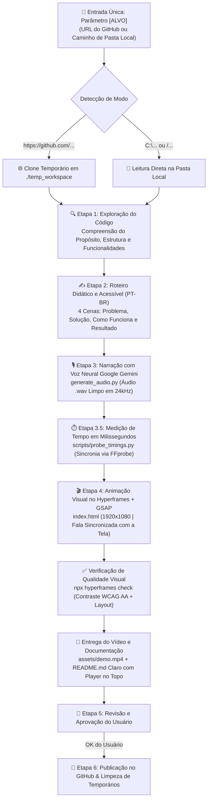

<div align="center">

# 🚀 AI Repo Launch Studio

**Torne Qualquer Repositório do GitHub Mais Acessível, Visual e Fácil de Entender com Vídeos Explicativos Gerados por IA**

[](https://www.python.org/)
[](https://nodejs.org/)
[](https://ai.google.dev/)
[](https://github.com/heygen-com/hyperframes)
[](https://ffmpeg.org/)
[](https://idx.dev/)

</div>

---

https://github.com/user-attachments/assets/8bb968b3-b2ad-4ea3-bcef-6c4ced52dcb0

---

## 💡 Sobre o Projeto

Entender o que um repositório faz apenas lendo longos blocos de texto e navegando por dezenas de pastas de código nem sempre é simples. Muitas vezes, projetos incríveis de **estudo**, **portfólio**, **análise de dados** ou **código aberto** deixam de ser compreendidos porque falta uma explicação visual, rápida e acessível logo no primeiro contato.

O **AI Repo Launch Studio** foi criado para democratizar a apresentação de projetos no GitHub, aproximando quem desenvolveu o código de quem está visitando o repositório. Basta informar o **link de um repositório remoto do GitHub** ou o **caminho de uma pasta local**: a ferramenta explora os arquivos, compreende o propósito do projeto, cria um roteiro didático em Português do Brasil, gera uma locução fluida com a **voz neural do Google Gemini**, sincroniza as animações em milissegundos via **Python + FFprobe** e renderiza um vídeo explicativo em **Full HD (1920x1080)** via **Hyperframes / GSAP** — sem precisar gravar telas ou editar vídeos manualmente.

### Para quem é esta ferramenta?
- 🎓 **Estudantes e Pessoas em Transição de Carreira**: Transforme exercícios, notebooks e projetos de cursos em apresentações claras que mostram o que você aprendeu.
- 💻 **Desenvolvedores Montando Portfólio**: Facilite a visualização do seu trabalho logo no topo do `README.md`, sem exigir que o visitante instale dependências apenas para ver o projeto funcionar.
- 🌍 **Criadores Open-Source e Comunidade**: Torne ferramentas, scripts e bibliotecas mais convidativos e didáticos para novos usuários e colaboradores.

---

## 🏗️ Como o Pipeline Funciona

O fluxo é orquestrado pelo arquivo [`prompt.txt`](./prompt.txt) em conjunto com os scripts em Python e o motor de renderização Hyperframes:



### Estrutura de Arquivos

```text
ai-repo-launch-studio/
├── assets/
│   └── demo.mp4                     # Vídeo oficial de demonstração deste repositório
├── brag-composition/                # Composição visual Hyperframes (HTML5/CSS3/GSAP)
│   ├── assets/
│   │   ├── audio/                   # Locuções .wav geradas por cena (ignoradas no Git)
│   │   ├── music/                   # Trilha instrumental suave de fundo (bgm_extended.mp3)
│   │   └── sfx/                     # Efeitos sonoros sutis de transição
│   ├── hyperframes.json             # Configuração do Hyperframes
│   ├── index.html                   # Telas animadas em Full HD 1920x1080 e timeline GSAP
│   └── package.json                 # Scripts de preview, check e render
├── scripts/
│   └── probe_timings.py             # Utilitário FFprobe para medir a duração exata de cada fala
├── .env.example                     # Modelo seguro para configuração da chave de API
├── .gitignore                       # Proteção para que o .env e arquivos temporários nunca subam ao Git
├── GEMINI.md                        # Regra de síntese de voz (garante leitura apenas do roteiro puro)
├── generate_audio.py                # Script Python de geração de voz neural com Google Gemini
├── prompt.txt                       # Motor de Orquestração Universal (Modo Local ou Remoto)
├── requirements.txt                 # Dependências Python (google-genai, python-dotenv)
└── README.md                        # Documentação do projeto
```

---

## ⚙️ Pré-requisitos e Instalação

Para rodar o projeto na sua máquina (**Windows**, **Linux** ou **macOS**), você precisará de:

1. **Node.js 22+** (com `npm` e `npx` no `PATH`)
2. **Python 3.11+**
3. **FFmpeg & FFprobe** instalados e acessíveis no terminal (`ffprobe -version`)
4. **Git** instalado
5. **Google Antigravity IDE** (ou ambiente agêntico compatível com a skill `brag` / `hyperframes`)

### Passo a Passo

#### 1. Clone o repositório
```bash
git clone https://github.com/Cesaraugusto916/ai-repo-launch-studio.git
cd ai-repo-launch-studio
```

#### 2. Crie o ambiente virtual Python e instale as bibliotecas
```bash
python -m venv .venv

# Ativar no Windows (PowerShell):
.\.venv\Scripts\Activate.ps1

# Ativar no Linux/macOS:
source .venv/bin/activate

pip install -r requirements.txt
```

#### 3. Configure sua chave gratuita do Google AI Studio
Copie o arquivo `.env.example` para `.env`:

```bash
# Windows (PowerShell)
Copy-Item .env.example .env

# Linux / macOS
cp .env.example .env
```

Abra o arquivo `.env` e cole sua chave `GEMINI_API_KEY`:
```env
GEMINI_API_KEY=sua_chave_do_google_ai_studio
```
> [!NOTE]
> O arquivo `.env` está protegido no [`.gitignore`](./.gitignore) para garantir que sua chave nunca seja enviada ao GitHub.

---

## 🚀 Como Usar (Modo Pasta Local vs. Modo Repositório Remoto)

Basta editar o parâmetro `[ALVO]` no arquivo [`prompt.txt`](./prompt.txt) e enviar o conteúdo ao agente no **Google Antigravity**:

### Opção 1: Explicar um Repositório Remoto do GitHub
1. No arquivo [`prompt.txt`](./prompt.txt), cole o link do repositório em `[ALVO]`:
   ```text
   [ALVO]: https://github.com/SeuUsuario/seu-projeto
   ```
2. Envie o prompt no chat do Google Antigravity.
3. O agente clonará o projeto em `./temp_workspace`, criará o roteiro didático, gerará a narração no Gemini, montará o vídeo em `./temp_workspace/assets/demo.mp4`, atualizará o `README.md` e aguardará o seu **"OK"** antes de publicar no GitHub e limpar a pasta temporária.

### Opção 2: Explicar uma Pasta Local no Seu Computador
1. No arquivo [`prompt.txt`](./prompt.txt), informe o caminho da pasta local em `[ALVO]`:
   ```text
   [ALVO]: C:\Users\SeuUsuario\Projetos\meu-projeto-local
   ```
2. Envie o prompt no chat do Google Antigravity.
3. O agente lerá os arquivos diretamente na pasta local sem precisar clonar, salvará o vídeo em `assets/demo.mp4` e atualizará o `README.md` na própria pasta do projeto, preservando todos os seus arquivos originais.

---

### Comandos Manuais (Opcional)

Se quiser executar as etapas diretamente pelo terminal:

```bash
# 1. Gerar os áudios de narração (.wav) e medir os tempos em timings.json
python generate_audio.py

# 2. Medir durações de arquivos de áudio com FFprobe
python scripts/probe_timings.py --dir brag-output/audio --out brag-output/audio/timings.json

# 3. Validar layout e contraste da composição Hyperframes
cd brag-composition
npx hyperframes check

# 4. Renderizar o vídeo final em Full HD (1920x1080)
npx hyperframes render --output ../assets/demo.mp4
```

---

## 🏆 Créditos

- **[Hyperframes](https://github.com/heygen-com/hyperframes)** & **[GSAP](https://gsap.com/)** — Composição visual e renderização determinística de vídeo em HTML/CSS/JS.
- **[latent-spaces/brag](https://github.com/latent-spaces/brag)** — Base de inspiração para apresentações em vídeo a partir do código-fonte.
- **[Google GenAI SDK (`google-genai`)](https://github.com/googleapis/python-genai)** — Síntese de voz neural natural com Google Gemini.
- **[FFmpeg](https://ffmpeg.org/)** — Medição de áudio de alta precisão via `ffprobe`.

---

<div align="center">
  Criado por <strong>César Carneiro</strong> — Gestor de Implementação de IA & Analista de Dados
</div>
